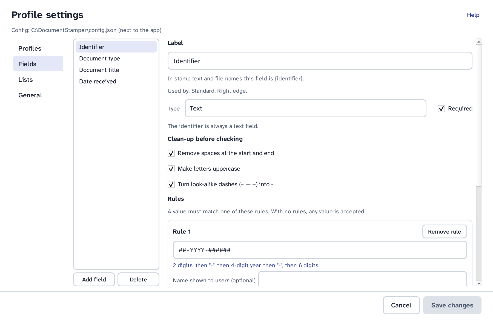
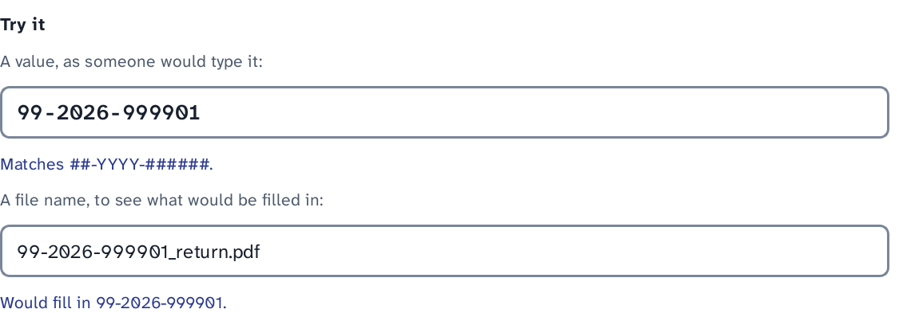
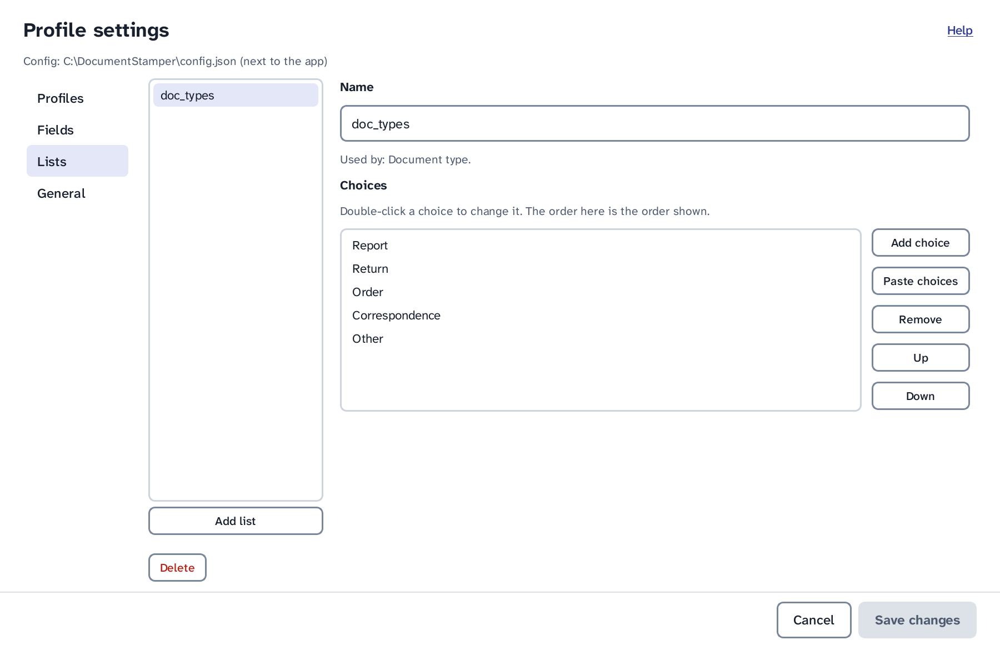

# Fields and lists

Fields are the values users type or pick in the stamp dialog. They're defined once, under **Fields** in Profile settings, and each profile chooses which of them it asks for.

## The fields list

The list on the left shows every field by its label.

- **Add field** adds a text field called "New field". Type its label straight away.
- **Delete** removes the selected field. A field that a profile still uses can't be deleted; the message names the profiles to take it out of first.

## The identifier

Every config has a field called `identifier`: the value the whole tool is built around, such as a case or file number. It can't be deleted and is always a text field, but you can give it any **Label**, for example "Case number" or "File number". Users see the label everywhere: in the stamp dialog, in messages, on the saved screen.

## Label and type

- **Label** is what users see. Change it whenever you like.
- The line under it shows the field's token, for example `{doc_title}`, used in stamp text and document properties. The token is made from the label when the field is added and never changes after that, so stamps keep working when you relabel a field.
- "Used by:" lists the profiles that ask for it.
- **Type**:
  - "Text": typed by the user, optionally checked against rules.
  - "Choice from a list": picked from a list; set which list under **Choices from**. Add lists under **Lists** first.
  - "Date": typed in the config's date format (set under **General**), and checked to be a real date.
- **Required**: users can't stamp until it has a value. Otherwise it shows as "(optional)" in the stamp dialog.

## Clean-up before checking

Applied to what the user types before it's checked and stamped:

- **Remove spaces at the start and end**
- **Make letters uppercase**
- **Turn look-alike dashes (– — −) into -**: en dashes, em dashes and minus signs, which often come in with text pasted from Word or email, become ordinary hyphens.

Keep "Make letters uppercase" ticked for fields whose rules contain letters, because rules compare letters exactly.

## Rules

Text fields can have rules: the formats a value must match. A value is accepted when it matches any one of them; with no rules, any value is accepted. Rules are explained in [Validation rules](validation-rules.md).

**Fill in from the file name when it contains a match**: when the file name contains exactly one value that matches a rule, the field is filled in for the user, who sees "Taken from the file name." Rules with `*`, and advanced rules, are never used for this, because they could match almost anything. If the box is ticked and no rule can be used, a red line under it says so; add a rule without `*`, for example `##-YYYY-######`.

## Try it

Type a value as a user would, and see whether it's accepted, which rule it matched, and what it would be saved as after clean-up. For fields filled in from the file name, type a file name too and see what would be filled in.

## Lists

Lists hold the choices for choice fields, such as document types.

- **Add list** adds a list; **Delete** removes one that no field uses.
- **Name**: rename a list here; the fields that use it follow the new name.
- **Choices**: double-click a choice to change it. **Add choice** adds one, **Paste choices** adds one choice per line of copied text (blank lines, lines with tabs or other control characters, lines over 128 characters and choices already in the list are skipped; at most 500 lines are read, and **Undo** takes the whole paste back), **Remove** removes the selected one, and **Up** and **Down** set the order users see.

A list can't be empty, and the same choice can't be listed twice (ignoring capitals).
