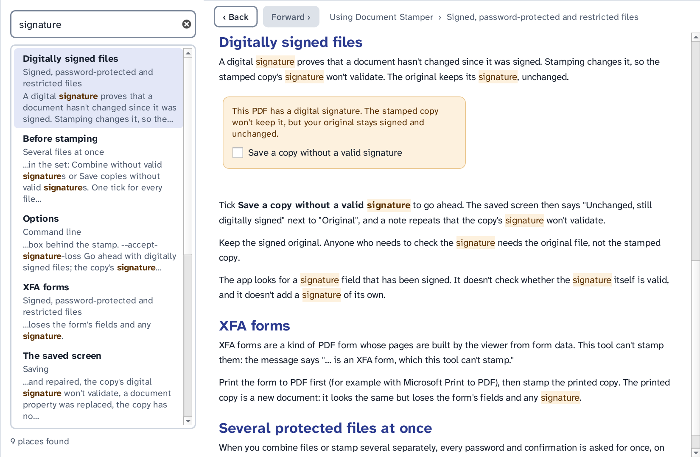

# Keyboard shortcuts

Everything can be done with the keyboard: Tab moves between controls, and Space ticks a box or presses the focused button.

## Everywhere

| Key | Does |
| --- | --- |
| F1 | Opens this help at the topic for the screen you're on. |
| Ctrl+O | **Choose files…**, on the drop screen, the saved screen and the batch results. |

Underlined letters are access keys: hold Alt and press the letter to go to that control or press that button.

## The stamp dialog

| Key | Does |
| --- | --- |
| Enter | **Stamp and save…**, once it's available. |
| Esc | **Cancel**: back to the drop screen, nothing saved; asks first if there are changes. While saving, stops the save. |
| Alt+S, Alt+C | **Stamp and save…** and **Cancel**. |
| Alt+P | Goes to **Position**. The chosen position is one Tab stop; the arrow keys move it, and stop at the edges. |
| Alt+D | Goes to **Direction**. |
| Alt+N | Goes to **Page numbers**. |
| Page Up, Page Down | The previous or next page in the preview. |

The same keys work when stamping a combined file or several files separately.

## The files and Before stamping screens

| Key | Does |
| --- | --- |
| Up, Down | Select a file in the list. |
| Alt+Up, Alt+Down | Move the selected file up or down the list. |
| Delete | Takes the selected file off the list. The file itself isn't touched. |
| Alt+C | **Cancel** on the files screen: back to the drop screen. |
| Enter in a password box | **Check** that password. |

## Profile settings

| Key | Does |
| --- | --- |
| Ctrl+S | **Save changes** |
| Esc | **Cancel**, asking first if there are changes. |

## The help window

| Key | Does |
| --- | --- |
| Ctrl+F | Puts the cursor in the search box. |
| Enter in the search box | Opens the first result. |
| Down in the search box | Moves into the results, to pick another with Up and Down and Enter. |
| Alt+Left, Alt+Right | **‹ Back** and **Forward ›**: through the topics you've looked at. |
| Esc | Clears the search; pressed again, closes the help. |

### Searching

Type one or more words. The results are the places in the help that contain every word, best matches first; each shows its topic and the line where the words are. Capitals don't matter, and part of a word finds the whole word: `sign` finds "signed" and "signature". Opening a result highlights the words in the topic.

Clear the search box to see the contents again. Click a picture in a topic to see it full size.
