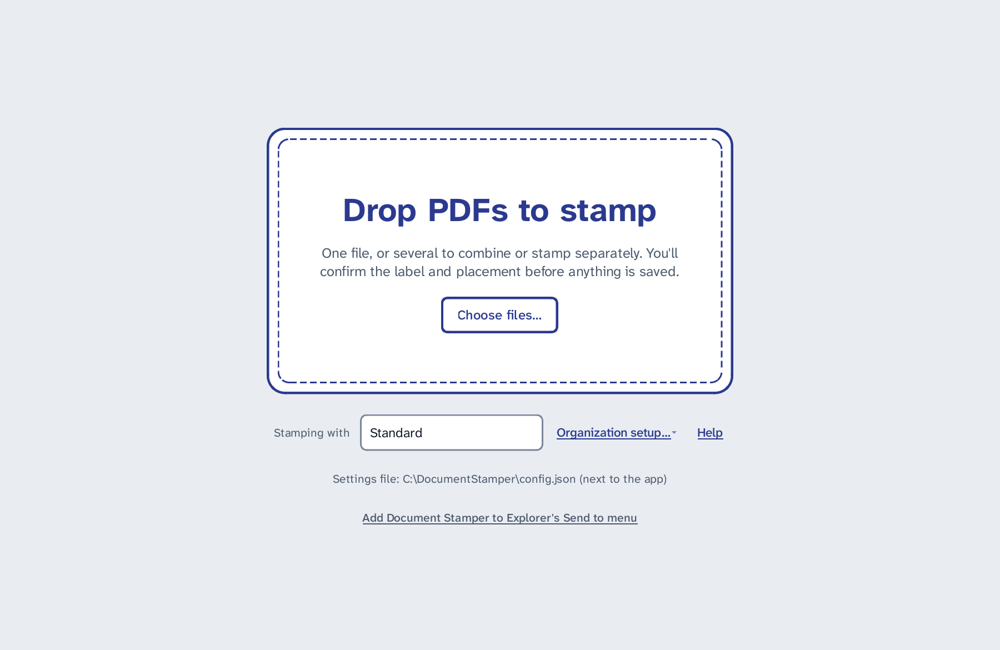
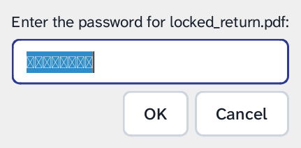

# Opening files

One PDF opens its stamp dialog. Several open the files screen, where you put them in order and choose to combine them or stamp each one (see [Several files at once](several-files.md)).

## Drop files on the window

Drag one or more PDFs from Explorer and drop them anywhere on the window. The drop target is highlighted while you drag. Dropping works on the drop screen, on the saved screen after a save, and on a batch's results, so you can go straight on to the next document.

## Choose files…

**Choose files…** opens the Windows file picker, showing PDF files. Pick one, or several with Ctrl or Shift. It starts in the folder you last opened a file from.

## Drag files onto the app

Dropping PDFs onto `DocumentStamper.exe`, or onto a shortcut to it, in Explorer starts the app with those files open: one file goes straight to its stamp dialog.

## Send to

Once it's set up, you can right-click PDFs in Explorer and choose *Send to › Document Stamper*. While it isn't set up, the drop screen offers **Add Document Stamper to Explorer's Send to menu** under the settings file line; click it to add the shortcut. It can also be added or removed from **Organization setup…** › **Edit profiles and fields…** › **General**; see [Send to menu and running from a USB drive](send-to-and-portable.md).

## Copies stamped this session

Once you've saved a copy, "Stamped this session" under the drop target lists the newest five, with the time and the original's name. **Show in folder** on a line opens that copy's folder in Explorer, with the copy selected. Point at a line to see where the copy was saved. The list covers one file, a combined file and each file saved in a batch. It isn't saved anywhere: it starts empty each time the app starts.

After **Stamp another with the same values**, a note on the drop screen says the next file you open starts with the last file's values and placement.

## Which profile is used

The list next to "Stamping with" shows the profile the next file will use. Pick another one before you open the file, or switch on the stamp screen (see [Switching the profile](stamping-one-file.md#switching-the-profile)). The app remembers your choice next time. When the settings file has only one profile, the list can't be changed.

Under it, the "Settings file:" line shows which settings file (`config.json`) is in use and where it came from: next to the app, in your user folder, the built-in default, or opened for this session. If the app finds a different settings file from the one it found last time, an amber note says so when it starts. Check the profile and fields before you stamp, because a different settings file can mean different rules. See [Where the config lives](where-the-config-lives.md).

## Organization setup…

**Organization setup…**, next to the profile list, is for whoever sets up Document Stamper for the agency or team. It opens a menu with two choices:

- **Edit profiles and fields…** opens Profile settings, where the profiles, fields, lists and date format are changed; see [Profiles and stamps](profiles-and-stamps.md). It's greyed out while no settings file is loaded.
- **Use a different settings file…** loads a different `config.json` for this session only, for example to try out one someone sent you. It isn't remembered: next time the app starts, it uses the usual settings file again. Problems in the file are listed on the drop screen and nothing changes.

## Files that need a password

If a PDF needs a password to open, you're asked for it.

A wrong password asks again and says so. Click **Cancel** to give up; the file isn't opened. The stamped copy keeps the same password; see [Signed, password-protected and restricted files](protected-files.md).

## Files that can't be opened

A message on the drop screen says why, and nothing else happens:

| Message | What to do |
| --- | --- |
| "… isn't a PDF file. Choose a PDF to stamp." | The file isn't a PDF inside, whatever its name ends with. Only PDFs can be stamped in this version. |
| "Can't find the file …" | It was moved or deleted after you chose it. |
| "… is damaged and can't be repaired" | The PDF is too broken to read. Try saving a new copy from the program that made it. |
| "… has no pages." | There's nothing to stamp. |
| "… is an XFA form, which this tool can't stamp." | Print it to PDF first (for example with Microsoft Print to PDF), then stamp the printed copy. |
| "… wasn't opened: it needs a password." | You cancelled the password prompt. Open it again to give the password. |

A file that was damaged but could be repaired opens normally, with a note to check the stamped copy carefully. See [Messages and what to do](messages.md).
