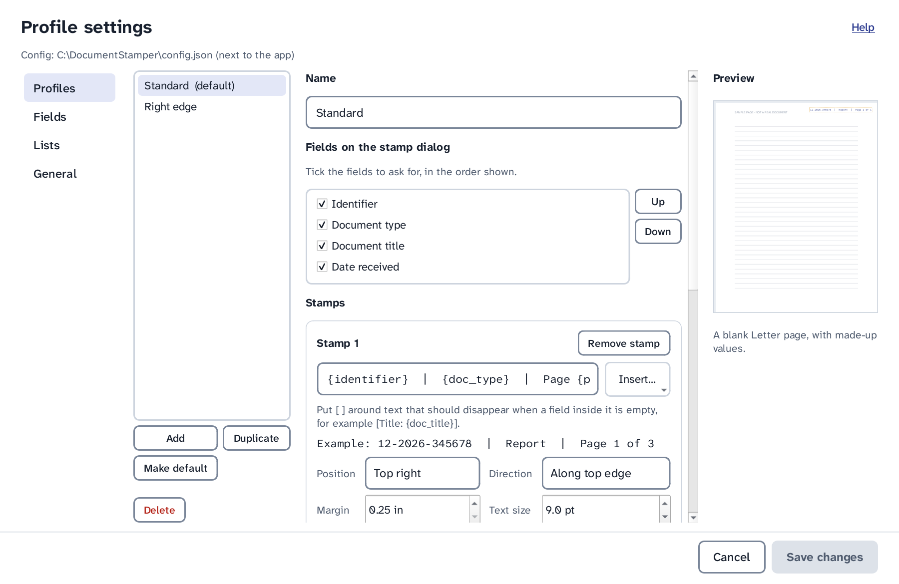
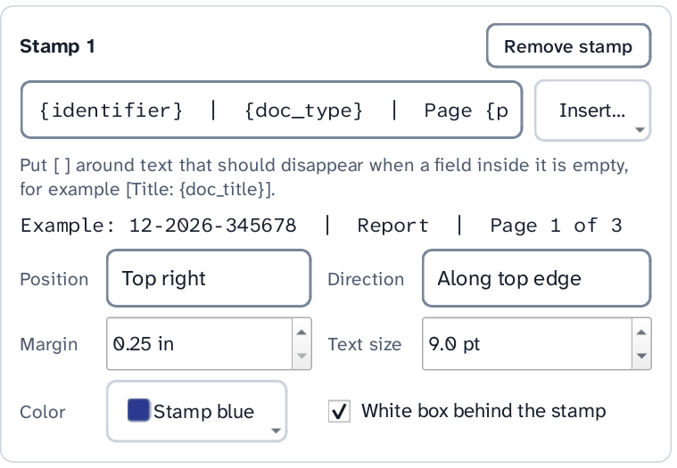
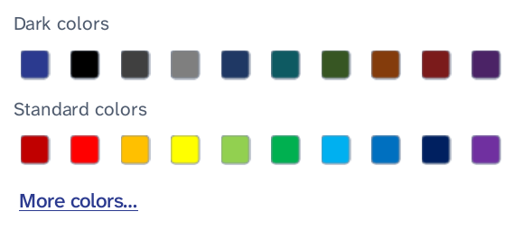

# Profiles and stamps

This part of the help is for whoever sets up Document Stamper for an agency or team. Everything an agency decides (its fields and formats, its document types, what the stamp says and where it goes) lives in one config file, edited in **Profile settings…** on the drop screen. Nothing agency-specific is built into the app.

## How Profile settings works

**Profile settings** has four sections, picked on the left: **Profiles**, **Fields**, **Lists** and **General**. The line under the title shows which config file you're editing and where it came from.

- Changes are checked as you make them. Anything that would stop the config loading is listed above the buttons ("Fix these before saving:"), and **Save changes** waits until the list is empty.
- **Save changes** (or Ctrl+S) writes the config file and keeps the previous version next to it as `config.json.bak`. The drop screen then uses the new settings.
- **Cancel** (or Esc) throws your changes away; it asks first if there are any. A deleted profile, field or list comes back too.
- After you delete or remove something (a profile, field, list, stamp, rule, choice or document property), or change a field's **Type** in a way that drops its rules, a message says what went and an **Undo** link sits beside it. **Undo** puts back the one last change. It's there until your next edit.
- Turning the mouse wheel over a drop-down list scrolls the page; it never changes the list. Click the list to pick, or use the arrow keys.
- A config file you can't write to opens read-only, with a note saying so. You can still look around and use **Export…** to save a copy with your changes. See [Where the config lives](where-the-config-lives.md).

Users only see a profile's effects: the fields they're asked for, the stamp, the suggested file name. Changing a profile changes it for everyone who uses that config file.

## Profiles

The list on the left shows every profile; "(default)" marks the one the app starts with, until a user picks another.

- **Add** makes a new profile with the identifier field and one stamp.
- **Duplicate** copies the selected profile, so you can make a variation.
- **Delete** removes it. The last profile can't be deleted.
- **Make default** makes it the one new users start with.

**Name** is what users see next to "Stamping with" and at the top of the stamp dialog.

### Fields on the stamp dialog

Tick the fields users are asked for with this profile, and use **Up** and **Down** to set the order they appear in. The fields themselves (their labels, rules and lists) are defined once under **Fields** and shared by every profile; see [Fields and lists](fields-and-lists.md).

A stamp, the file name and the document properties can only use fields ticked here.

## Stamps

Each profile has one or more stamps. Each stamp is one line of text printed on every page, at its own position.

### Stamp text

The text is written with `{tokens}` where values go. **Insert…** lists the tokens you can use:

| Token | Printed as |
| --- | --- |
| `{identifier}`, `{doc_type}` … | The value of that field (the profile's fields are listed by their labels). |
| `{page}` | Page number |
| `{total}` | Number of pages |
| `{original_name}` | Original file name, without `.pdf`. For a combined file, the first file's name. |
| `{date}` | Today's date, in the config's date format. |

For example, `{identifier}  |  {doc_type}  |  Page {page} of {total}` prints `99-2026-999901  |  Report  |  Page 1 of 3`.

When a field is left empty, its token disappears along with the separator before it, so an empty document type gives `99-2026-999901  |  Page 1 of 3`. If an empty token starts the stamp, the separator after it goes instead.

Put square brackets around text that should disappear with an empty field: `[Title: {doc_title}  |  ]{identifier}` prints nothing for the title part when there's no title. **Insert…** › "Optional part  [ ]" adds the brackets for you. To print a real brace or bracket, double it: `{{`, `}}`, `[[`, `]]`.

The "Example:" line under the text shows the stamp as it would print on page 1 of 3, with made-up values that fit your rules.

### Where it goes and how it looks

| Setting | What it does |
| --- | --- |
| **Position** | One of nine places on the page. |
| **Direction** | Along top edge, across the page; or along right edge, turned to run down the side. |
| **Margin** | Distance from the page edges, from 0.25 to 3 inches. |
| **Text size** | 6 to 24 points; 9 is the default. A stamp that doesn't fit on a small page is made smaller, down to 6 pt. |
| **Color** | Pick from **Dark colors**, which suit stamps, or **Standard colors** (Word's ten), or **More colors…** for any color. A color that is hard to read on white gets a note. |
| **White box behind the stamp** | On by default. Users can turn it off for one document in the stamp dialog. |

Users can move the stamp with the identifier, and move page numbers to the bottom, for one document at a time. Any other stamp always prints where the profile puts it.

**Add a stamp** adds another stamp (it starts as "Page {page} of {total}" at the bottom right); **Remove stamp** removes one. A profile always has at least one stamp. Two stamps that would overlap on a page can't be saved by users; place them apart.

### Preview

The picture on the right shows the profile's stamps on a blank Letter page with made-up values, and redraws as you change things. It comes back once any problems listed below are fixed.

## File name

What users see ticked in the stamp dialog's **File name** selector to start with.

- Tick fields, and **Today's date**, and put them in order with **Up** and **Down**.
- **Separator** goes between the parts (usually `_`). It can't contain a character Windows doesn't allow in file names.
- **Add the original file name** puts the original file's name at the end.

The "Example:" line shows a name built from made-up values. The rules for building names are in [File name](stamping-one-file.md#file-name).

## Document properties

Values written into the copy's document properties (what Windows and PDF viewers show under Properties), so other systems can find or index the copy.

- **Add a property**: give it a name (letters, digits and underscores, starting with a letter) and a value, which can use tokens, for example `Identifier` = `{identifier}`.
- `{page}` and `{total}` can't be used here, because they change from page to page.
- **Remove** deletes a property.

The copy also keeps the original's existing properties. See [What changes in the stamped copy](what-changes.md#document-properties).
