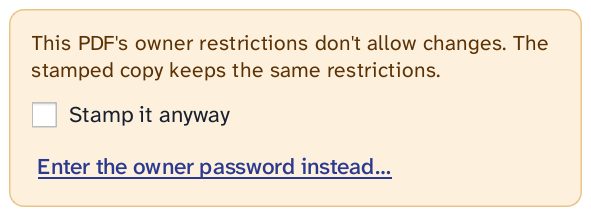

# Signed, password-protected and restricted files

Some PDFs need a step from you before they can be stamped. The original is never changed whichever you choose.

## A password to open

If a PDF needs a password just to open it, you're asked for it when you open the file (see [Opening files](opening-files.md#files-that-need-a-password)).

## A password for the stamped copy

When the original is protected (it needs a password to open, or has owner restrictions), the stamp dialog asks what the copy gets, under "Password for the stamped copy":

- **Keep the original's password and permissions**: the copy opens with the same password and has the same restrictions.
- **No password**: the copy has no password and no restrictions. A note under **Check the copy** says so, and that to keep the same level of protection you should encrypt the file or keep it only on encrypted drives and shares.
- **Set a password**: type a new password twice. The copy is saved with AES-256 encryption, opens only with that password, and has no restrictions. It can have up to 40 characters: unaccented letters, digits, spaces and the symbols on a US keyboard.

When the original needed a password to open, nothing is chosen for you and **Stamp and save…** waits until you pick one. When it only has owner restrictions, keeping them is chosen already. A new password isn't prefilled, isn't saved anywhere, and is forgotten once the copy is saved or you leave the screen.

**Stamp each file separately** asks the same question once for all the protected files in the set ("Keep each original's password and permissions"). Combining asks differently; see [Several files at once](several-files.md#a-password-for-the-combined-file).

## Files set not to allow changes

Some PDFs open without a password but are set not to allow changes, by whoever produced the file (PDF tools call these *owner restrictions* or *permissions*). Stamping is a change, so the dialog asks first. Your original isn't touched either way.

You have two ways on:

- Tick **Stamp a copy**. This is the usual way. Whether the copy keeps the setting is chosen under "Password for the stamped copy" (above).
- Click **I have the permissions password (optional)…** if you have it (PDF tools also call it the owner password). If it allows changes, the tick is replaced by "Permissions password given; changes allowed". A password that opens the file but doesn't allow changes is refused, and you can try again.

Whether you may stamp a restricted file is a question about where it came from, not about this tool. Check your agency's practice if you're not sure.

## Digitally signed files

A digital signature proves that a document hasn't changed since it was signed. Stamping changes it, so the stamped copy's signature won't validate. The original keeps its signature, unchanged.

Tick **Save a copy without a valid signature** to go ahead. The saved screen then says "Unchanged, still digitally signed" next to "Original", and a note repeats that the copy's signature won't validate.

Keep the signed original. Anyone who needs to check the signature needs the original file, not the stamped copy.

The app looks for a signature field that has been signed. It doesn't check whether the signature itself is valid, and it doesn't add a signature of its own.

## XFA forms

XFA forms are a kind of PDF form whose pages are built by the viewer from form data. This tool can't stamp them: the message says "… is an XFA form, which this tool can't stamp."

Print the form to PDF first (for example with Microsoft Print to PDF), then stamp the printed copy. The printed copy is a new document: it looks the same but loses the form's fields and any signature.

## Several protected files at once

When you combine files or stamp several separately, every password and confirmation is asked for once, on the "Before stamping" screen, before anything is saved. See [Before stamping](several-files.md#before-stamping).
