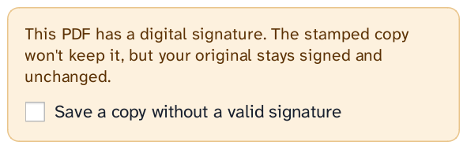

# Signed, password-protected and restricted files

Some PDFs need a step from you before they can be stamped. The original is never changed whichever you choose.

## A password to open

If a PDF needs a password just to open it, you're asked for it when you open the file (see [Opening files](opening-files.md#files-that-need-a-password)).

The stamped copy keeps the original's password and permissions, so it opens with the same password. A note in the stamp dialog says so: "The copy keeps the original's password and permissions."

Combining is different: a combined file is saved without any password. See [Several files at once](several-files.md#combine-or-stamp-each-file-separately).

## Owner restrictions

Some PDFs open without a password but carry *owner restrictions*: settings, made by whoever produced the file, that don't allow changes. Stamping is a change, so the dialog asks first.

You have two ways on:

- Tick **Stamp it anyway**. The stamped copy keeps the same restrictions as the original.
- Click **Enter the owner password instead…** if you have the owner password. If it lifts the restrictions, the tick is replaced by "Owner password given; restrictions lifted". The copy still keeps the original's password settings and permissions. A password that opens the file but doesn't lift the restrictions is refused, and you can try again.

Whether you may stamp a restricted file is a question about where it came from, not about this tool. Check your agency's practice if you're not sure.

## Digitally signed files

A digital signature proves that a document hasn't changed since it was signed. Stamping changes it, so the stamped copy's signature won't validate. The original keeps its signature, unchanged.

Tick **Save a copy without a valid signature** to go ahead. The saved screen then says "Unchanged, still digitally signed" next to "Original", and a note repeats that the copy's signature won't validate.

Keep the signed original. Anyone who needs to check the signature needs the original file, not the stamped copy.

The app looks for a signature field that has been signed. It doesn't check whether the signature itself is valid, and it doesn't add a signature of its own.

## XFA forms

XFA forms are a kind of PDF form whose pages are built by the viewer from form data. This tool can't stamp them: the message says "… is an XFA form, which this tool can't stamp."

Print the form to PDF first (for example with Microsoft Print to PDF), then stamp the printed copy. The printed copy is a new document: it looks the same but loses the form's fields and any signature.

## Several protected files at once

When you combine files or stamp several separately, every password and confirmation is asked for once, on the "Before stamping" screen, before anything is saved. See [Before stamping](several-files.md#before-stamping).
