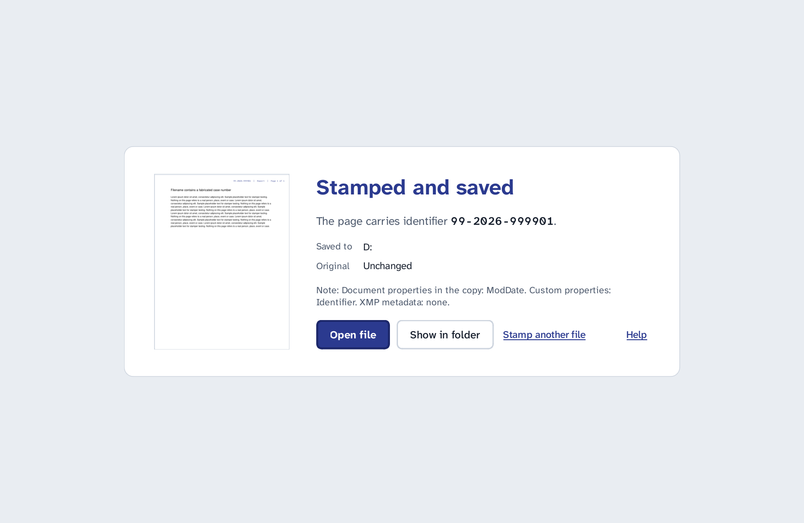

# Saving

## Save As

**Stamp and save…** opens the Windows Save As window. It starts in the original file's folder with the suggested name filled in (see [File name](stamping-one-file.md#file-name)). Change the folder or the name if you need to; a name without `.pdf` gets it added.

Save As can't be shown in these pictures, because it's part of Windows.

## Never over the original, never over another file

The window won't save:

- over the original: "That's the original file. The stamped copy is always saved as a new file; choose a different name or folder."
- over any file that already exists: "… already exists. Choose another name; the window never replaces an existing file."
- into a folder that doesn't exist.

The message appears above the buttons. Click **Stamp and save…** again and choose another name or folder. Windows' own "Do you want to replace it?" question is never offered, because the answer is always no.

When combining, none of the original files can be chosen either.

## While it saves

A progress bar shows "Stamping page 5 of 40…", then "Saving…" while the file is written. Click **Cancel**, or press Esc, to stop while the pages are being stamped: "Stamping was cancelled. Nothing was saved." Once "Saving…" shows, the save finishes; it can't be stopped halfway.

Just before writing, the app checks that the original is still the file you opened. If it was changed, moved or replaced while the dialog was open, nothing is saved: "The original, …, changed after you opened it. Open it again so the copy matches what you checked."

## The saved screen

**Stamped and saved** shows:

- the first page of the stamped copy, read back from the saved file
- how many pages carry the stamp, and the identifier, so you can check it once more
- **Saved to**: the full path of the copy
- **Original**: "Unchanged", or "Unchanged, still digitally signed" for a signed file, or "All N files unchanged" after combining
- any notes about the copy (see [Messages and what to do](messages.md))

A note lists the document properties the copy carries, for example: "Document properties in the copy: ModDate. Custom properties: Identifier. XMP metadata: none." This matters if the copy is going to be disclosed; see [What changes in the stamped copy](what-changes.md#document-properties).

Then:

- **Open file** opens the copy in your PDF viewer. Look through it before sending it anywhere.
- **Show in folder** opens its folder in Explorer, with the copy selected.
- **Stamp another file** goes back to the drop screen. You can also drop the next file straight onto this screen.

After stamping several files separately, a results list is shown instead; see [The results](several-files.md#the-results).
