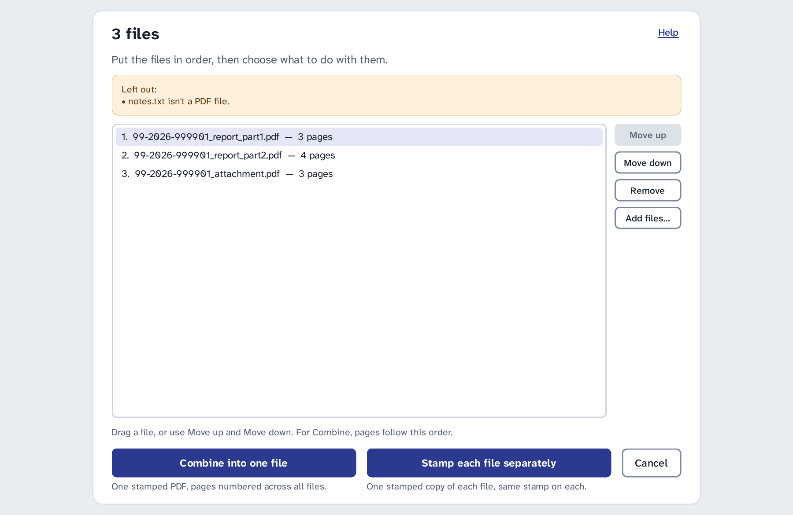
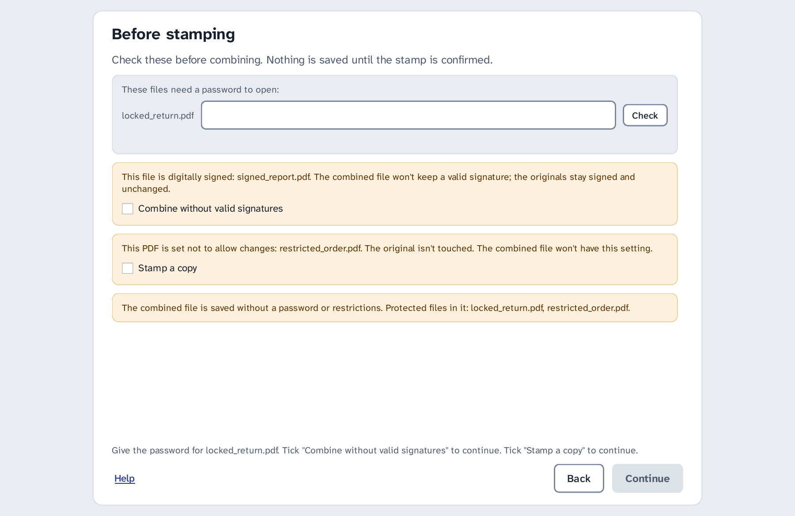
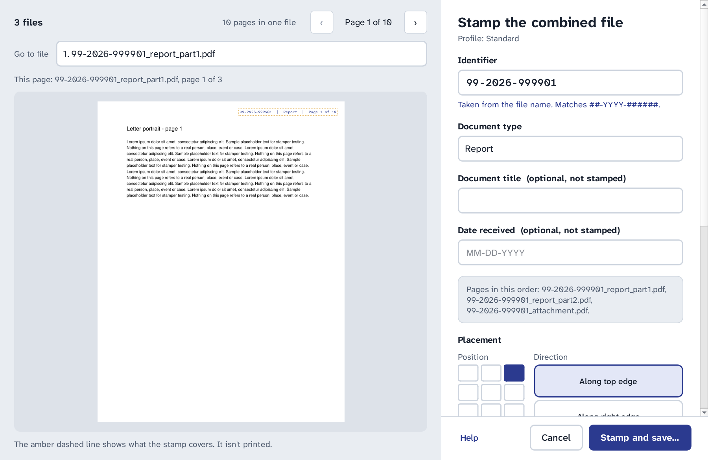
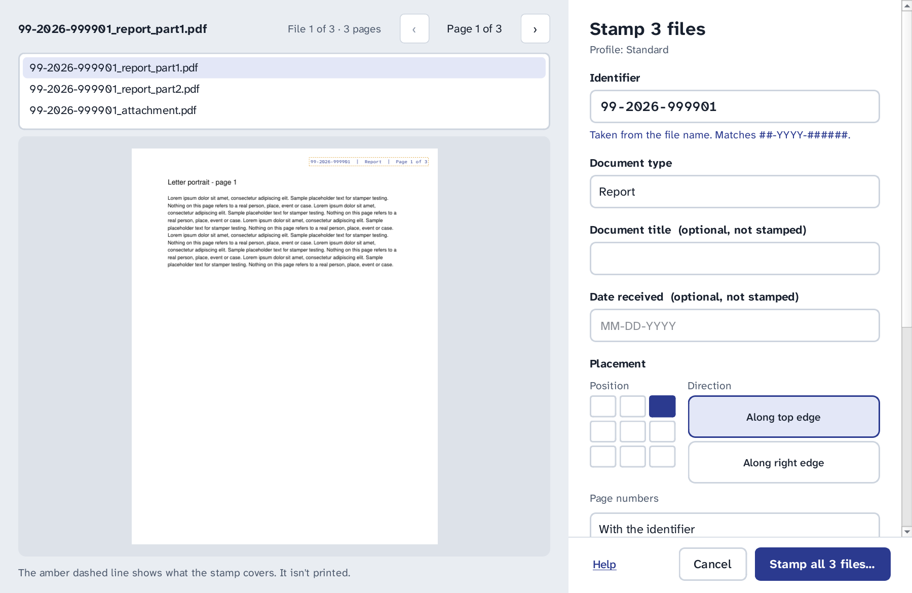
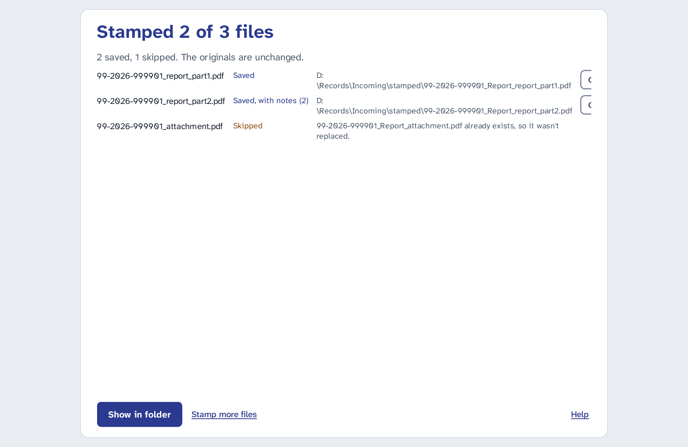

# Several files at once

Drop several PDFs on the window (or pick several with **Choose files…**, or send several with *Send to*) and the files screen opens.

## The files screen

The files are listed in order, each with its page count, or "needs a password".

- Drag a file up or down the list, or select it and use **Move up** and **Move down**. For Combine, the pages follow this order.
- **Remove** takes the selected file off the list. The file itself isn't touched.
- **Add files…** adds more from the file picker.
- **Back** goes back to the drop screen.

Files that can't be used are listed under "Left out" with the reason: they can't be found, are listed twice, aren't PDF files, are XFA forms, or are damaged beyond repair. The others carry on without them.

If only one file is left, the screen offers to stamp it on its own instead.

### A large set

With more than 50 files, or more than 2,000 pages in all, you're asked to confirm before going on, because checking and saving take a few minutes. Click **Go ahead** to continue.

## Combine or stamp each file separately

There's no default; choose each time.

**Combine into one file** makes one stamped PDF from all the files, pages in the order shown, with page numbers running across the whole file ("Page 12 of 40"). Use it when the files are parts of one document, such as a return that arrived in pieces.

- One set of values and one placement for the whole file.
- The combined file has one bookmark for each original file, with that file's own bookmarks under it.
- The combined file is saved *without a password or restrictions*, even when some of the originals had them. You're told which files were protected before anything is combined.
- Form fields with the same name in two files are renamed so they stay separate; a note lists them.
- Page labels (such as "i, ii, iii") and accessibility tags from the originals aren't kept. Attached files are kept.
- The names of the original files, with the pages each one became, are recorded in the combined file's document properties (as `StamperSources`). See [What changes in the stamped copy](what-changes.md#combined-files).

**Stamp each file separately** makes one stamped copy of each file, all with the same values and placement. Use it for a set of separate documents that belong to the same identifier. Each copy keeps its own original's password and permissions.

## Before stamping

When any file needs something from you, the "Before stamping" screen collects it all up front, before anything is combined or saved:

- A password box for each file that needs one. Type it and press Enter or click **Check**. "Opens the file." means it's right.
- One tick for every digitally signed file in the set: **Combine without valid signatures** or **Save copies without valid signatures**.
- One tick for every file with owner restrictions: **Stamp it anyway** (or **Stamp them anyway**). When combining, the combined file has no restrictions; when stamping separately, each copy keeps its own.
- When combining files of which any is protected, the warning that the combined file is saved without a password or restrictions.

The line above **Continue** says what's still needed. **Back** returns to the files screen.

## Stamping the combined file

After "Combining N files…" (with a progress bar and **Cancel**), the combined file opens in a stamp dialog titled **Stamp the combined file**. It works like [Stamping one file](stamping-one-file.md), with a few additions:

- **Go to file** jumps the preview to the first page of any of the original files. The line under it says which file and page you're looking at: "This page: report_part2.pdf, page 1 of 4".
- A note lists the files in page order, and any signed files you confirmed.
- Values are filled in from the file names only when every file name that contains one agrees. If they disagree, the field is left empty and an amber note lists what each name suggests: check that the files really belong together, then type the value.
- In the stamp and the file name, the original file name is the first file's. The suggested name ends with `_combined`, and Save As starts in the first file's folder.

The combined file is built in a private work folder in your user profile (`%LOCALAPPDATA%\DocumentStamper\work`) and deleted when you save, cancel or close. If that folder can't be used (for example it's full, or on a network drive), the working copy goes in a hidden folder next to the first file instead, and an amber note says so. That working copy has no password, even if the originals had one, until it's deleted.

## Stamping each file separately

The stamp dialog for a batch, titled "Stamp N files", has a list of the files above the preview. Click a file to preview its pages with the same values and placement.

- The suggested name under **File name** is for the file shown. Each copy is named from its own original.
- **Save the copies**: **Next to each original** (the default), or **In one folder**, which asks for the folder.
- A page problem in the file shown, such as a stamp that doesn't fit, doesn't stop the button: that file will be reported instead of saved.

Click **Stamp all N files…**. Every file is checked first. If some can't be saved as set up (a copy with that name already exists, two files would get the same name, or the stamp doesn't fit), you're told which and why, and asked whether to stamp the others. Answer no and nothing is saved.

**Cancel** while it's stamping stops the batch: the file in progress isn't saved and the rest aren't started. Copies already saved stay, and the results list says which.

## The results

The results list each file as **Saved** (with **Open** to open the copy), **Skipped** (a file with that name already exists, so nothing was replaced), **Failed** (with the reason), or **Cancelled** / **Not started** if you cancelled. The originals are unchanged.

A copy with notes reads **Saved, with notes (N)**. **Show notes** opens them under the row, laid out as on the [saved screen](saving.md#the-saved-screen), and **Hide notes** closes them again.

When some files can't be stamped, the question before stamping the others also lists the notes for the files that will be saved.

**Open folder** shows the first saved copy in Explorer. **Stamp more files** goes back to the drop screen, or drop more files on the window.
