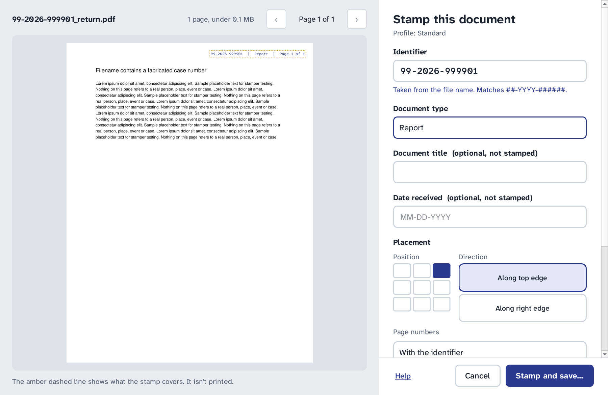
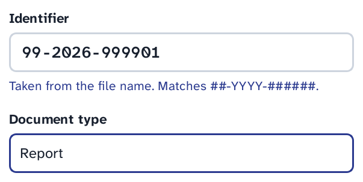
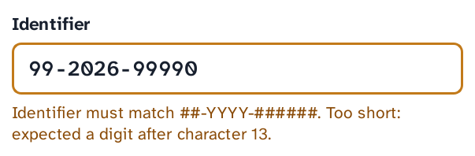
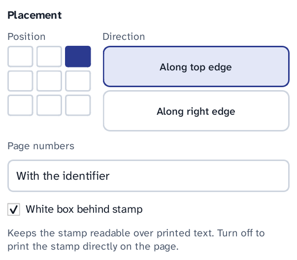
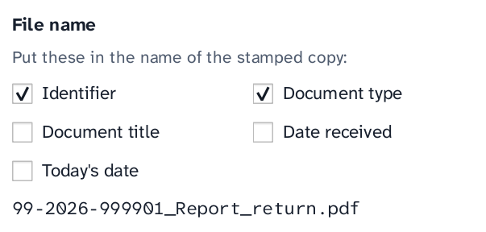
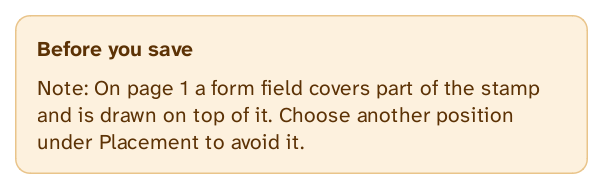
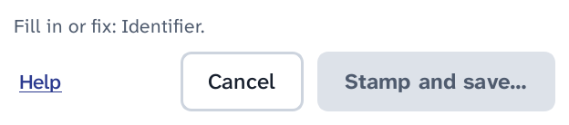

# Stamping one file

When you open one PDF, its stamp dialog opens: the page preview on the left, the fields and placement on the right.

Nothing is saved until you click **Stamp and save…** and choose where. **Cancel** (or Esc) goes back to the drop screen without saving anything.

## The preview

The preview shows one page with the stamp drawn exactly as it will print. An amber dashed line around the stamp shows the area it covers; the line isn't printed.

Above the preview are the file name, its page count and size, and the page buttons. Use **‹** and **›**, or Page Up and Page Down, to look at other pages. Check pages that differ from the first: a landscape page, a small receipt, a page with a form field in the corner.

The preview redraws as you type and click. Every change is also checked against every page of the document, not just the one on screen, before **Stamp and save…** can be used.

## Fields

The fields come from the profile shown under the title ("Profile: …"). Each field is one of three kinds:

- *Text*: type the value. The identifier field is shown in a font where 0 and O, 1 and l look different.
- *Choice*: pick from the list. A required choice starts at "Choose…"; an optional one at "(none)".
- *Date*: type the date in the format shown in the empty box, for example MM-DD-YYYY.

Next to a field's name, "(optional)" means you can leave it empty, and "(not stamped)" means the value isn't printed on the pages. It's still used in the file name or the document properties, if the profile puts it there.

### Checking as you type

A message under each field says whether the value is acceptable. When the field has rules (for example, the format an identifier must follow), it names the rule the value matched: "Matches ##-YYYY-######." If the rule contains a date, the date is written out so you can check it.

When the value doesn't fit, the box turns amber and the message says what's wrong and where: "Too short: expected a digit after character 13." Fix it to continue.

Before checking, the value is cleaned up the way the field is set to: spaces at the start and end removed, letters made uppercase, and look-alike dashes (– — −) turned into an ordinary hyphen. The stamp uses the cleaned-up value, so typing `99–2026–999901` with en dashes stamps `99-2026-999901`.

Values are refused if they are longer than 128 characters, or if they contain hidden characters such as a right-to-left mark or a zero-width space. These can come in with pasted text and make a value look different from what would be stamped. The message names the character and its position; retype the value.

### Dates in the future

If an identifier contains a date that is later than today, an amber note says so: "The date in this identifier, …, is in the future. Check it before saving." It doesn't stop you saving, because the date may be right.

## Filled in from the file name

If a field is set to, and the file name contains exactly one value that fits the field's rules, the field is filled in for you and the message starts "Taken from the file name." Always check it: the file name may be wrong. Change it like any other value.

Nothing is filled in when the file name contains no match, or two different matches.

## Placement

The placement controls move the main stamp (the one with the identifier) for this document only. The profile isn't changed, and the next document starts from the profile's placement again.

- **Position**: nine places on the page. Corners and edge centers keep the profile's margin from the edges.
- **Direction**: **Along top edge** runs the stamp across the page. **Along right edge** turns it 90° to run down the side of the page, reading from top to bottom, which leaves the top of the page clear.

Positions and directions are as you see the page. A page stored on its side (rotated) is stamped where it looks right when viewed, not where the stored page's top happens to be.

### Page numbers

**Page numbers** chooses where "Page 1 of 3" goes:

- **With the identifier**: as part of the main stamp, as the profile has it.
- **Bottom left**, **Bottom center** or **Bottom right**: as a separate stamp at the bottom of each page, with the same size and color. The rest stays where it was.

Some profiles can't offer every choice. A note under the list says why: the stamp has no page number, the page number can't be separated from the rest of the stamp, or another stamp already uses that position. When a profile already prints page numbers as a stamp of their own, **As in the profile** keeps them where the profile puts them.

### White box behind stamp

**White box behind stamp** draws a white box under the stamp text, so it can be read over printed text or a scanned page. It's on unless the profile says otherwise. Turn it off to print the stamp directly on the page.

The box hides what is under it on the page, but doesn't remove it: the covered content is still in the file. See [What changes in the stamped copy](what-changes.md).

### When the stamp doesn't fit

On a small page, the stamp is made smaller to fit, half a point at a time, down to 6 pt. A note under "Before you save" names each page where that happened. If it still doesn't fit at 6 pt, a message under **Placement** says which page and how much room it needs. Shorten the values, run it **Along right edge**, or pick another position. Two stamps that would overlap are refused the same way.

## File name

Tick the fields to put in the name of the stamped copy. The ones the profile chooses are ticked to start with; **Today's date** adds today's date in the config's date format. The suggested name is shown under the ticks, and you can still change it in the Save As window.

How the name is built:

- The ticked values, in the order shown, then the original file name, joined with the profile's separator (usually `_`).
- A value that was filled in from the original file name isn't repeated: `99-2026-999901_return.pdf` becomes `99-2026-999901_Report_return.pdf`, not `99-2026-999901_Report_99-2026-999901_return.pdf`.
- Characters Windows doesn't allow in file names (`< > : " / \ | ? *`) and spaces become `-`.
- Names are kept to 120 characters. If it's longer, the original name is shortened first.

## Before you save

Notes about the whole document appear under "Before you save" when there's something worth knowing first: a form field covering part of the stamp, a page where the text was made smaller, a damaged file that was repaired, very large or very small pages, a document property the copy will change, or a file that contains JavaScript, attached files or earlier versions. They don't stop you saving. [Messages and what to do](messages.md) explains each one.

## Stamp and save…

**Stamp and save…** is available once every required field is filled in correctly, every tick box a warning asks for is ticked, and every page has been checked with exactly what is on screen. Until then, the line above the button says what is still needed, for example "Fill in or fix: Identifier." or "Checking all pages…".

Enter does the same as clicking it. Then choose where to save; see [Saving](saving.md).
