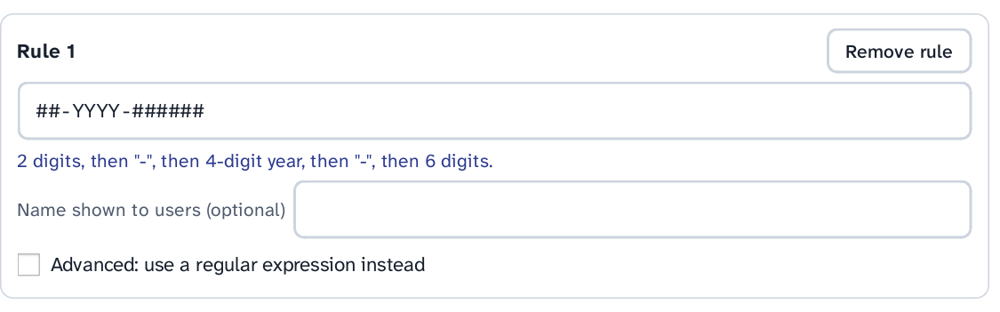
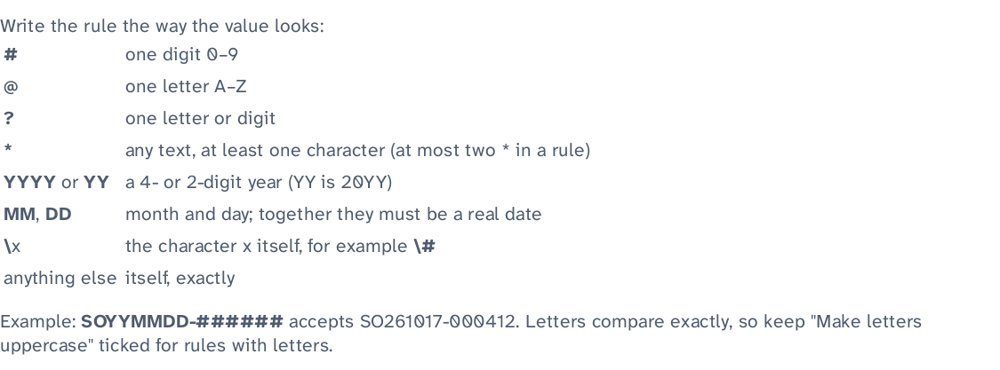

# Validation rules

A rule describes what a valid value looks like, so a mistyped identifier is caught before it's stamped on every page. Rules belong to text fields and are edited under **Rules** in the **Fields** section of Profile settings.

## Writing a rule

Write the rule the way the value looks, using these characters:

| In the rule | Matches |
| --- | --- |
| `#` | one digit, 0 to 9 |
| `@` | one letter, A to Z |
| `?` | one letter or digit |
| `*` | any text, at least one character (at most two `*` in a rule) |
| `YYYY` or `YY` | a 4-digit or 2-digit year (`YY` means 20YY) |
| `MM` and `DD` | a month and a day; together with the year they must make a real date |
| `\` then a character | that character itself, for example `\#` for a real `#` |
| anything else | itself, exactly |

Examples:

| Rule | Accepts | Refuses |
| --- | --- | --- |
| `##-YYYY-######` | `99-2026-999901` | `99-2026-99990` (too short) |
| `@@YYMMDD-######` | `AB261017-999902` | `AB261317-999902` (there's no 13th month) |
| `FILE-*` | `FILE-7` and `FILE-ANY TEXT` | `FILE-` (nothing after the dash) |

Under the rule, a sentence says how it reads it, for example "2 digits, then "-", then 4-digit year, then "-", then 6 digits." If that isn't what you meant, change the rule. A rule that can't be read says why.

Letters in a rule are compared exactly, so `AB` doesn't match `ab`. Keep **Make letters uppercase** ticked for fields whose rules contain letters, and users can type either.

**How to write a rule** shows the table above inside Profile settings; **More in Help** opens this topic.

## Several rules

A field can have more than one rule; a value only has to match one. This is how a field accepts two numbering schemes, such as an older and a newer format. **Add a rule** adds one; **Remove rule** removes it. With no rules at all, any value is accepted.

When a value matches, users see "Matches" and the rule (or its name). When it doesn't, the message names the rule it came closest to and where it went wrong, for example "Too short: expected a digit after character 13."

**Name shown to users (optional)** replaces the rule in those messages with a name, such as "New format". Leave it empty to show the rule itself, which is usually clearer.

## Dates in rules

`YYYY`, `YY`, `MM` and `DD` are checked as a date: `MM` must be 01 to 12 and `DD` a day that month has, including 29 February only in leap years. A rule with only a year checks the year is four (or two) digits.

When a value contains a date that's later than today, users get an amber note asking them to check it. It doesn't stop them saving.

## Advanced: regular expressions

Tick **Advanced: use a regular expression instead** to write the rule as a Python regular expression. Use this only when the simple characters can't describe the format.

- It must match the whole value (no `^` and `$` needed).
- It works on ASCII: `\d` means 0 to 9 only.
- Dates aren't checked.
- It's never used to fill in a value from the file name.
- Expressions that can take a very long time to check are refused as soon as they're typed, with the reason: a repeat inside a repeat, such as `(a+)+`; alternatives that can match the same text inside a repeat; two open-ended repeats side by side that can match the same characters; and backreferences. Rewrite it without that, or use a simple rule.

The same checks run whenever a config file is loaded, so a risky expression in a config edited by hand is refused too.

## Testing rules

Use **Try it** at the bottom of the field's settings: type values the way users would, including wrong ones, and check what's accepted. See [Try it](fields-and-lists.md#try-it).
