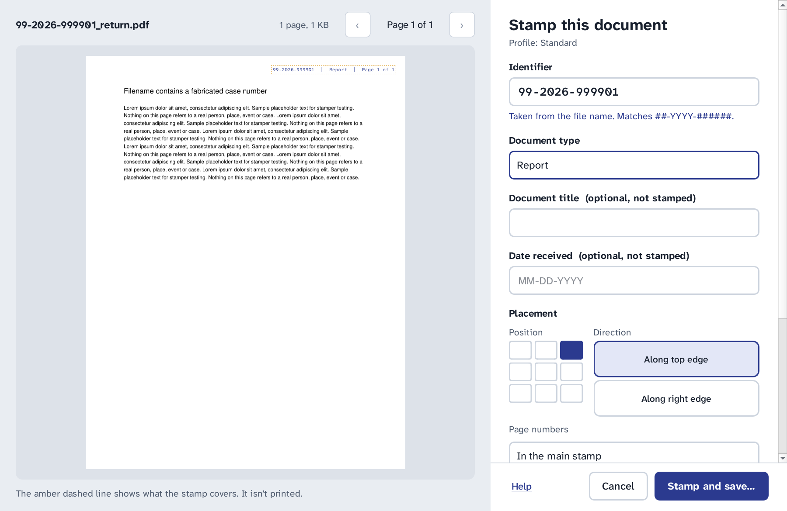

# What Document Stamper does

Document Stamper adds a line of text, a *stamp*, to every page of a PDF and saves the result as a new file. A typical stamp carries the identifier the document belongs to, the document type and the page number:

`99-2026-999901  |  Report  |  Page 1 of 3`

## The original is never changed

- The file you open is only read. Nothing is ever written to it.
- The stamped copy is always a new file. The window won't save over the original, or over any file that already exists; it asks you to choose another name instead.
- The copy is written to a temporary file in the folder you chose, and renamed to the name you chose only once it's complete. A failure never leaves a half-written file under that name. If the app is stopped at exactly that moment, the temporary file stays behind and the app offers to delete it next time (see [Partial copies left behind](messages.md#partial-copies-left-behind)).

The stamped copy is a new save of the whole document, so a few things about it differ from the original. They are listed in [What changes in the stamped copy](what-changes.md).

## How it works

1. Open a PDF: drop it on the window, or click **Choose files…**. See [Opening files](opening-files.md).
2. Fill in the fields. The preview shows the stamp on the page, exactly where it will print. See [Stamping one file](stamping-one-file.md).
3. Move the stamp or change how page numbers are shown, if the document needs it.
4. Click **Stamp and save…** and choose where to save. The suggested file name is built from the fields.
5. The saved screen shows where the copy went, and anything worth checking. See [Saving](saving.md).

To stamp several PDFs at once, drop them together. You can combine them into one stamped file, or stamp each one separately with the same values. See [Several files at once](several-files.md).

## Profiles

What goes in the stamp, which fields you're asked for, where the stamp sits and how the copy is named all come from a *profile*. There can be several, one for each kind of submission, and you choose one on the drop screen next to "Stamping with". Profiles are set up under **Organization setup…** › **Edit profiles and fields…**, usually by whoever looks after the tool; see [Profiles and stamps](profiles-and-stamps.md).

## What it remembers, and what it doesn't

- It remembers the profile you used last, the folder you last opened a file from, and which config file it found when it started.
- It never remembers field values. Every document starts empty, apart from what is filled in from its file name.
- It keeps no log of the documents you stamp and doesn't connect to the network.

## What it can stamp

PDF files, including password-protected, restricted and digitally signed ones (each needs a step from you; see [Signed, password-protected and restricted files](protected-files.md)). It can't stamp XFA forms. Images, Word documents and text files aren't handled in this version.

## Getting help

Press F1 on any screen, or click **Help**, to open this help at the topic for that screen. Type in the search box at the top left to find a word anywhere in the help. See [Keyboard shortcuts](keyboard.md#the-help-window).
