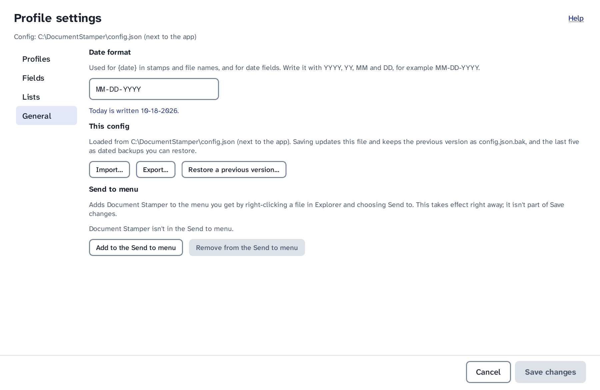

# Where the config lives

All of an agency's settings (profiles, fields, rules, lists and the date format) are in one file, `config.json`. Every copy of the app reads one config file when it starts.

## Where the app looks

When it starts, the app uses the first of these it finds:

1. *Next to the app*: `config.json` in the same folder as `DocumentStamper.exe`. This copy travels with the app: copy the folder, or a USB drive, and its settings go too.
2. *In your user folder*: `%APPDATA%\DocumentStamper\config.json`, for settings that belong to one Windows user.
3. *The built-in default*: generic settings shipped inside the app, with one "Standard" profile and an "Identifier" field that accepts any value. It's never changed.

The drop screen shows which one is in use, on the "Settings file:" line under the profile list, and so does the top of Profile settings.

If the app finds a different file from the one it found last time, it says so in an amber note when it starts. That can happen when someone puts a `config.json` next to the app, or a copy of the app is run from somewhere else. Check the profile and fields before stamping.

A config file larger than 1 MB is refused without being read.

## Saving

**Save changes** in Profile settings writes back to the file that was loaded:

- First it lists what you changed (profiles, fields and lists added or removed, fields renamed, stamp text, rules and the date format) and asks you to confirm. Cancel is the default, and Ctrl+S asks the same way. When the file is the copy next to the app, it also says that everyone who starts Document Stamper from that folder gets these settings.
- The previous version is kept next to it as `config.json.bak`, and the last five versions are also kept as `config.json.YYYYMMDD-HHMMSS.bak` (date and time of the save). Older dated backups are deleted; no other file in the folder is touched.
- The new file is written completely before it replaces the old one, and only if it would load. A half-written or broken config is never left behind.
- The file is written in the app's own layout. Spacing or key order you used when editing it by hand isn't kept.

If you're looking at the built-in default, saving creates a `config.json` next to the app if that folder can be written to, otherwise in your user folder. A note at the top of Profile settings says which.

## Read-only configs

A config file you can't write to (made read-only, or in a folder where you don't have write access) opens read-only in Profile settings, with a note. You can look at every setting and try values, but not save. **Export…** still saves a copy with your changes, for someone who can update the shared file.

This is the way to stop a team changing a shared config: make the file read-only (or put the app in a folder they can't write to). The app has no passwords or user accounts of its own.

## This config: Import…, Export… and Restore a previous version…

Under **This config** in **General**:

- **Export…** saves what's on screen, including changes you haven't saved, as a config file wherever you choose. Use it to send settings to another computer or keep a copy.
- **Import…** loads a config file into Profile settings, replacing all profiles, fields and lists. It first lists what would change (profiles, fields and lists added or removed, fields relabelled) and asks you to confirm. Nothing changes on disk until you click **Save changes**, and the file it replaces is kept as `config.json.bak`.

- **Restore a previous version…** opens the config's folder showing only its backups (`config.json.bak` and the dated ones). The one you pick is loaded exactly like **Import…**: checked, listed, confirmed, and not written until you click **Save changes**. Saving it makes a new backup of the version it replaces.

A file with problems can't be imported or restored; the problems are listed.

## Date format

**Date format** sets how dates are written in stamps (`{date}`), in file names (**Today's date**) and in date fields. Write it with `YYYY`, `YY`, `MM` and `DD` and any separators, for example `MM-DD-YYYY`, `YYYY-MM-DD` or `DD.MM.YYYY`. The line under it shows today's date in that format.

## Trying another config

**Organization setup…** › **Use a different settings file…** on the drop screen uses a different config file for this session only, without moving or copying anything, and isn't remembered. Use it to check a config before putting it in place. Profile settings then edits that file.

## What's stored besides the config

| What | Where | Why |
| --- | --- | --- |
| The last profile, the last folder a file came from, and which config was found | `%APPDATA%\DocumentStamper\state.json` | So the app opens where you left off. Never field values. |
| Combined files while you stamp them | `%LOCALAPPDATA%\DocumentStamper\work\` | Deleted when you save, cancel or close. |
| A list of copies being written | `%LOCALAPPDATA%\DocumentStamper\pending\` | So partial copies can be found after a crash. Each entry is removed once its copy is saved. |
| A blank sample page for the Profile settings preview | Windows' temporary folder | Removed when you close Profile settings. |
| The Send to shortcut, if you add it | `%APPDATA%\Microsoft\Windows\SendTo\` | See [Send to menu and running from a USB drive](send-to-and-portable.md). |

Apart from these, the app writes only the copies you save (and, when combining can't use the work folder, a hidden working folder next to your files; see [Stamping the combined file](several-files.md#stamping-the-combined-file)).
